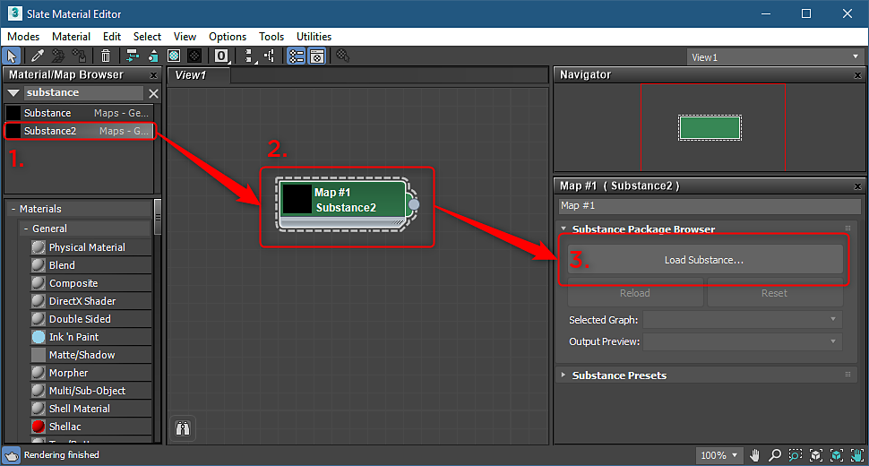
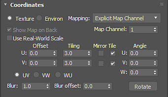
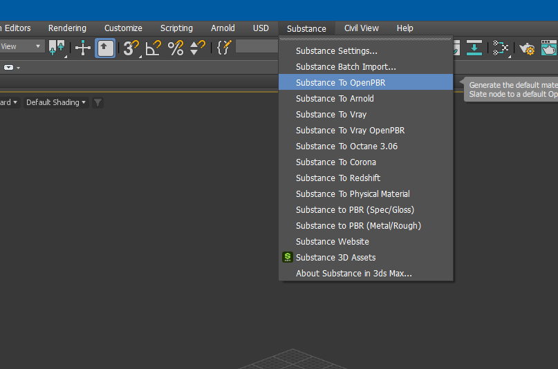

# Présentation de la Substance dans 3ds Max

## Présentation des plug-ins

## Ouverture d’une Substance

1. Ouvrez l’éditeur d’ardoise, recherchez Substance et faites glisser le nœud Substance 2 vers la vue.
1. Double-cliquez sur le nœud de Substance pour activer les propriétés et, sous Explorateur de packages de Substances, chargez une Substance.

   >[!NOTE]
   >
   > Vous pouvez également glisser-déposer le fichier .fichier sbsar dans l’éditeur d’ardoise pour créer automatiquement le nœud et importer la barre verticale.

1. Si une Substance contient plusieurs graphes, vous pouvez choisir le graphe que vous voulez sortir en tant que matériau dans le menu déroulant Graphe sélectionné.

   

1. Une fois le nœud de Substance sélectionné, accédez au menu Substance et choisissez un moteur de rendu pris en charge. Le matériau sera créé et prêt à être appliqué à l’objet. Les textures de Substance sont liées au matériau de rendu.

>[!NOTE]
>
> Une fois le nœud **« Substance 2 »** sélectionné, vous devez d&#39;abord cliquer sur **Charger la Substance...** pour sélectionner un fichier sbsar, puis sélectionner un moteur de rendu pris en charge dans le menu supérieur (par exemple « Substance vers Arnold »).
>
>Les systèmes de rendu pris en charge sont Arnold, V-Ray, Corona et Octane. [En savoir plus sur les workflows dans 3DS Max pour découvrir comment utiliser les matériaux.](../using-workflows-3ds-max/using-workflows-in-3ds-max.md)

## Modification de la résolution

1. Définissez la résolution souhaitée pour les textures de Substance calculées dans les Paramètres de sortie de Substance.
1. Pour une résolution allant jusqu&#39;à 8K, assurez-vous d&#39;utiliser le moteur GPU, qui est défini dans les [Paramètres de Substance](../../../3d-applications/3ds-max/settings-1/substance-settings.md).

   

## Modification des paramètres

1. Double-cliquez sur le nœud de Substance pour charger les paramètres de Substance dans la fenêtre des paramètres.
1. Modifiez les paramètres pour mettre à jour automatiquement les textures de Substance.

   {width="500px"}

## Définition de l’aperçu de la sortie

Vous pouvez définir un canal spécifique pour la vignette du nœud de Substance.

1. Dans la liste déroulante Aperçu de la sortie, choisissez le canal à utiliser pour la vignette du nœud.

   

## Substances de répétition

Vous pouvez utiliser les propriétés Coordonnées pour afficher en mosaïque les textures de Substance et définir les couches de courbe de transfert.

## Workflows d’OpenPBR

Deux workflows OpenPBR sont disponibles dans la **liste des workflows** à partir du **menu Substance** : **Substance vers OpenPBR** et **Substance vers OpenPBR V-Ray**. Ces workflows sont conçus pour être utilisés avec des fichiers SBSAR créés à l’aide de l’OpenPBR dans Substance 3D Designer ou Sampler (OpenPBR est le modèle par défaut depuis Designer V16.0+ et Sampler V6.0+).

### Qu’est-ce que l’OpenPBR ?

OpenPBR est un modèle d&#39;ombrage de matériau physique ouvert développé par Adobe et Autodesk et contribué à l&#39;Academy Software Foundation (ASWF). Elle fournit une définition de matériau unifiée compatible entre les systèmes de rendu. Pour plus d&#39;informations, consultez la [documentation OpenPBR](https://experienceleague.adobe.com/fr/docs/substance-3d/general-knowledge/openpbr/openpbr-overview).

### Quand utiliser un workflow OpenPBR

Utilisez un workflow OpenPBR lorsque votre Fichier sbsar a été créé à l’aide de l’modèle de matériau dans Substance 3D Designer ou Substance 3D Sampler. Si votre SBSAR a été créé à l’aide d’un modèle de matériau standard d’Adobe (ASM), utilisez le workflow hérité compatible avec votre système de rendu (Arnold, V-Ray ou V-Ray 6).

>[!NOTE]
>
> Si vous appliquez un workflow OpenPBR à un matériau ASM, ou un workflow standard à un OpenPBR SBSAR, le module externe connectera uniquement les sorties communes aux deux modèles de matériau. Le résultat peut être incomplet.

### Workflows d’OpenPBR disponibles

**OpenPBR**

Utilise le nœud openPBRSurface natif de 3ds Max. Compatible avec Arnold et V-Ray. Il s’agit du workflow recommandé pour la plupart des utilisateurs qui travaillent avec des OpenPBR dans 3ds Max.

**OpenPBR - V-Ray**

Utilise le matériau V-Ray (VRayMtl) en mode OpenPBR. Recommandé pour les utilisateurs dont le pipeline est spécifiquement construit autour des configurations de matériau V-Ray.

### Application d’un workflow OpenPBR

1. Sélectionnez votre Fichier sbsar (OpenPBR) à l’aide du bouton Charger la Substance.
1. Dans le menu supérieur, sélectionnez OpenPBR ou OpenPBR - V-Ray.
1. Cliquez sur Créer un réseau pour créer le réseau shader dans l’éditeur de Matériau d’ardoise.
1. Le plug-in connecte automatiquement les sorties SBSAR aux entrées correspondantes de l&#39;OpenPBR.
1. Attribuez le matériau à votre maillage comme d’habitude.

