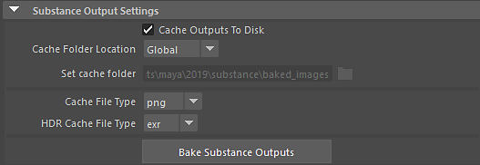

# Substance en Maya Aperçu

## Présentation des plug-ins

La Substance pour le module externe Maya vous permet de charger n’importe quel matériau Substance 3D existant (.Fichier sbsar) directement dans Maya. Les matériaux Substance 3D peuvent être créés et exportés sous forme de fichiers SBSAR à partir de Substance 3D Designer ou Substance 3D Sampler, puis téléchargés à partir de bibliothèques existantes telles que la bibliothèque Substance 3D Assets. La Substance du module externe Maya permet de créer des matériaux Maya et d’alimenter les textures de sortie avec les entrées de canal de matériau appropriées

>[!NOTE]
>
> Assurez-vous que le plug-in est chargé dans Paramètres/Préférences ->Gestionnaire de plug-ins Maya

## Ouverture d&#39;un Fichier sbsar dans l&#39;éditeur de nœuds Hypershade

1. Ouvrez **Hypershade** et dans l&#39;**éditeur de nœuds**, faites un clic droit et balayez vers le haut dans le menu de marquage pour choisir **Créer un nœud**. Dans la fenêtre **Créer un nœud**, recherchez et sélectionnez le **nœud de Substance**.

   

   Cliquez sur le **nœud de Substance** dans Hypershade pour le sélectionner. L&#39;**Éditeur de Matériau** s&#39;ouvre. Vous pouvez charger votre matériau Substance 3D (Fichier sbsar) en cliquant sur l&#39;icône de dossier.

1. Vous pouvez également glisser-déposer un Fichier sbsar dans l&#39;**éditeur d&#39;hyperombre** de Maya, puis cliquer sur le nœud de Substance automatiquement créé pour afficher et modifier directement les options dans l&#39;**éditeur de Matériau**.

### Lire avec les paramètres SBSAR dans l’éditeur de propriétés

1. La liste déroulante **Graphe sélectionné** s&#39;affiche si la Substance contient plusieurs graphes. Sélectionnez le graphe à utiliser pour créer le matériau.

1. Le bouton **Informations sur le Graphe** affiche les attributs de graphe définis dans la Substance Designer.

1. Définissez la résolution en définissant les valeurs **Largeur** et **Height**. Désactivez **Verrouiller le rapport** pour choisir des rapports non carrés.

1. Activez **Sorties du cache sur le disque** pour baker les Sorties de Substance de données sur le disque afin qu&#39;elles puissent être utilisées avec des systèmes de rendu tels qu&#39;Arnold. Le fichier mis en cache sera relu par le plug-in à l’aide d’un nœud de fichier Maya.

   

1. Choisissez un workflow pour le moteur de rendu que vous utilisez et cliquez sur le bouton **Créer un réseau Shader**. Un réseau shader est créé pour le workflow de rendu. Pour les versions 3.1.1., la liste des workflows offre également la possibilité de créer des réseaux en OpenPBR. Une fois le réseau shader créé, vous pouvez appliquer le matériau dans la scène.

   {width="1000px"}

## Dépannage

Pour signaler un bug, rejoignez le canal #maya-plugin sur le [serveur Substance Discord](https://discord.com/invite/substance3d) ou visitez les [communautés d&#39;Adobes](https://community.adobe.com/t5/substance-3d-plugins/ct-p/ct-substance-3d-plugins?page=1&sort=latest_replies&lang=all&tabid=all&topics=label-autodesk3dsmax). L’ajout d’informations pertinentes dans le journal de la console et lors des étapes de reproduction nous aidera à diagnostiquer le problème plus efficacement.